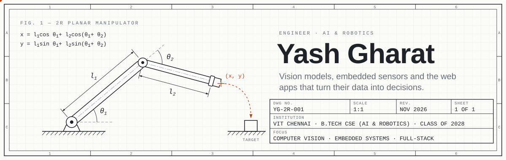

<picture>
  <source media="(prefers-color-scheme: dark)" srcset="assets/header-dark.svg">
  
</picture>

I build systems where software meets the physical world: vision models, ESP32 sensor rigs, and the React and Node.js apps that make their data useful. I'm a third-year B.Tech CSE (AI & Robotics) student at VIT Chennai, graduating in 2028.

**Open to Summer 2027 internships** (mid-May to end of July) in robotics, embedded systems, AI/ML or full-stack, and to part-time remote work during the semester.

[Portfolio](https://yash-portfolio-five-henna.vercel.app) · [LinkedIn](https://www.linkedin.com/in/yash-gharat-264940288) · [9e23.yashgharat22@gmail.com](mailto:9e23.yashgharat22@gmail.com)

## Selected work

**[UrbanPulse](https://github.com/yashg2006/SmartCity)** — City monitoring for drains, garbage and mosquito swarms. Readings from ESP32 sensors and detections from a YOLOv8 vision server are fused into a live 0–100 breeding-risk score, which Socket.IO pushes to a React and Node.js dashboard. The system is the basis of a published Indian patent application.
 React · Node.js · MongoDB · Socket.IO · Flask · YOLOv8 · OpenCV · ESP32

**[MorphGuard](https://github.com/yashg2006/MorphedGaurd)** — Flags tampered certificates by combining EXIF checks, Error Level Analysis, noise-variance analysis and a CNN into one suspicion score. I wrote the IPC manager, sync manager and deadlock handler myself, so the forensic pipelines run in parallel without races.
 Python · Flask · TensorFlow · OpenCV · scikit-image · PostgreSQL · Gunicorn

**[Obsidian](https://github.com/yashg2006/obsidian)** ([live demo](https://obsidian-1-i6r1.onrender.com)) — A real-time 3D exoplanet simulator. GLSL shaders build each planet's terrain, oceans and atmosphere from fractal noise, and a habitability engine scores it with the Stefan–Boltzmann law and a Goldilocks-zone model, using data from the NASA Exoplanet Archive.
 React Three Fiber · Three.js · GLSL · Node.js · Express · Prisma

## Research

- **Patent:** *A System and Method for Civic Infrastructure Monitoring*, Indian Patent Application No. 202641111183, published September 2026. I'm a co-inventor; VIT Chennai is the applicant.
- **[Spatial-TME-Pipeline](https://github.com/yashg2006/Spatial-TME-Pipeline):** explainable graph neural networks for breast-cancer classification from spatial transcriptomics. The manuscript is under journal review.
- **[qgaff-space-debris-detection](https://github.com/yashg2006/qgaff-space-debris-detection):** quantum-guided feature transformation for cross-domain space-debris detection.
- **[AI-Disinfo-Shield](https://github.com/yashg2006/AI-Disinfo-Shield):** a multimodal, knowledge-graph-augmented framework for verifying disinformation.

## Experience

- **Software Development Intern**, Adarsha Nagari Sahakari Ltd, with Syncwork Technologies (May–Jul 2026). Tested SyncLMS 2.0, the society's production loan management system. I documented more than 30 critical defects, and production issues fell 25% across three sprints.
- **Research Intern**, VIT Chennai (Aug 2024 – May 2026).

## Toolbox

Mostly C++, Python and JavaScript. React, Node.js and Flask on the web side; OpenCV, YOLOv8 and TensorFlow for vision; ESP32 boards for hardware; Linux, Git and Docker throughout.

Also: winner of Before Build (Zero Bugs Club) · prize winner, AI Workshop mini-hackathon, IIT Bombay Techfest 2024
